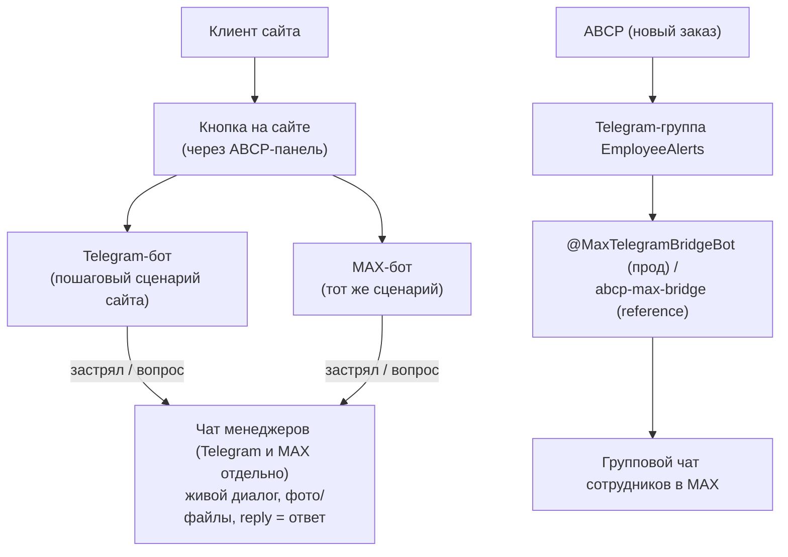
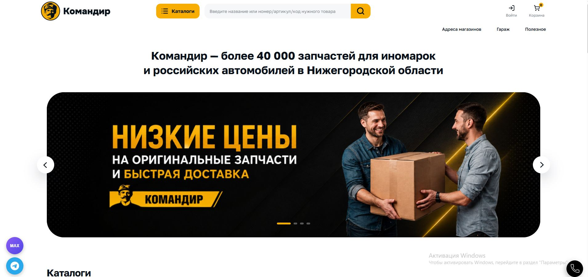
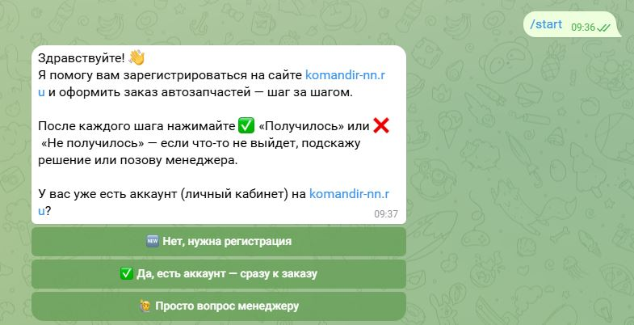
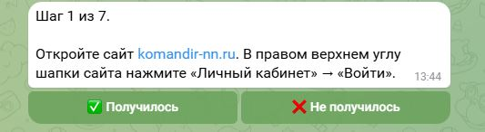
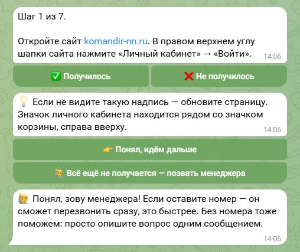
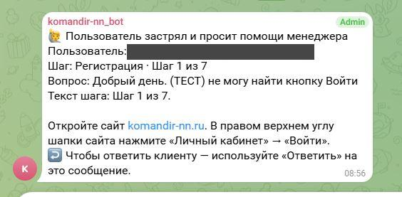
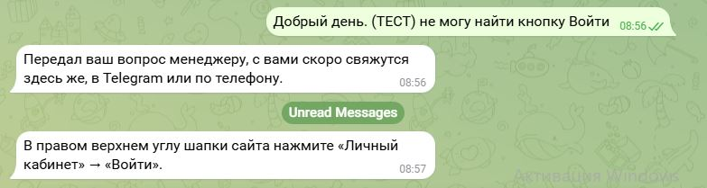
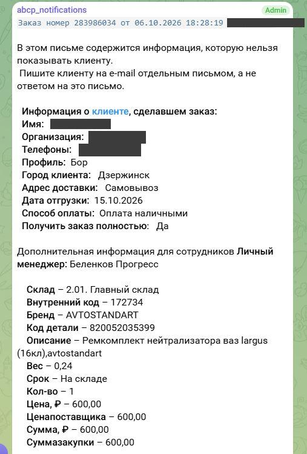
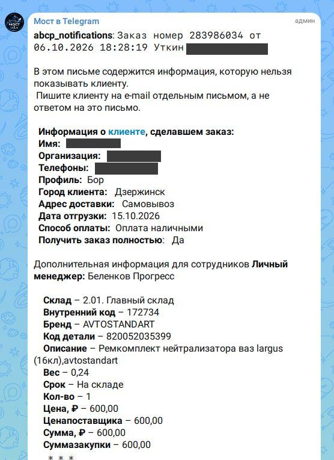

# Омниканальная поддержка клиентов «Командир»: Telegram + MAX + мост из ABCP

MVP-система, которая ведёт клиента розничной сети автозапчастей «Командир»
(komandir-nn.ru, платформа ABCP) через регистрацию и оформление заказа на
сайте — в Telegram и в MAX — и параллельно дублирует сотрудникам уведомления
о новых заказах из ABCP в оба мессенджера.

## Проблема

Клиенты интернет-магазина на ABCP иногда теряются на сайте: не могут
зарегистрироваться, не понимают, как оформить заказ, бросают корзину. Чтобы
получить помощь, им приходится звонить или писать в абстрактную «поддержку»
и ждать. Отдельно — сотрудники получают уведомления о новых заказах только
в Telegram-группе (так настроено в ABCP), а часть команды работает в MAX и
эти уведомления не видит.

## Решение

1. **Telegram-бот [@komandirnn_bot](https://t.me/komandirnn_bot)** (создан
   через [@BotFather](https://t.me/BotFather)) и **MAX-бот** (создан через
   [dev.max.ru](https://dev.max.ru), зарегистрирован в кабинете
   [business.max.ru](https://business.max.ru)) — пошагово ведут клиента по
   реальному интерфейсу сайта (регистрация, корзина, оформление заказа). На
   каждом шаге — кнопки «✅ Получилось» / «❌ Не получилось»; если не
   получилось — подсказка, а если и это не помогло — живой диалог с
   менеджером прямо в чате (с фото/файлами, если нужно показать проблему).
2. **Мост ABCP → MAX** — слушает Telegram-группу, в которую ABCP уже шлёт
   уведомления о новых заказах, и дублирует каждое сообщение в групповой чат
   сотрудников в MAX — без доработок на стороне ABCP.
3. **Коннектор к ABCP** (скилл `publish-bot-to-site`) — у ABCP нет
   публичного API для управления контентом/виджетами сайта, поэтому
   коннектор написан поверх веб-панели `cp.abcp.ru`: сам находит и правит
   нужный инфоблок (`bodyScripts`) через его HTML-редактор и публикует
   плавающую кнопку-ссылку на бота в углу сайта komandir-nn.ru, не
   перекрывая уже существующие виджеты.

## Для кого полезен

- Для предпринимателей и команд поддержки интернет-магазинов на ABCP (или
  похожих self-service платформах), которым нужно снизить отток клиентов на
  сложных шагах регистрации/заказа.
- Для команд, часть которых работает в Telegram, а часть — в MAX, и нужно
  не плодить ручное дублирование уведомлений.

## Что умеет проект

- Ведёт клиента по сценарию «регистрация → заказ» с подсказками на каждом
  шаге (сценарий — реальный граф шагов в `src/steps.js`, легко редактируется).
- Пробрасывает «застрявшего» клиента на живого менеджера: текст, телефон
  (нативная кнопка «Отправить номер»), фото/файлы — одним сообщением в чат
  менеджеров.
- Менеджер отвечает клиенту нативным «Ответить» в Telegram/MAX — бот сам
  находит нужного клиента по chat_id/user_id, поиск вручную не нужен.
- После успешного оформления заказа — мягкое напоминание оставить отзыв о
  магазине, со ссылками на Яндекс.Карты и 2ГИС.
- Ведёт журнал событий (`data/events.jsonl`) — на каких шагах чаще всего
  «❌ Не получилось», сколько вопросов дошло и было отвечено
  (разбор — `python bot_stats.py [--days N] [--bot telegram|max]`).
- Дублирует уведомления о заказах из ABCP в MAX без изменений на стороне ABCP.
- Собственный **коннектор к ABCP** (`publish-bot-to-site`) — публикует
  плавающую кнопку бота на сайте через веб-панель `cp.abcp.ru` в обход
  отсутствия у ABCP публичного API для контента, с учётом уже существующих
  виджетов и мобильной вёрстки.

## Скриншоты

### Кнопка на сайте (коннектор к ABCP)

Кнопки Telegram и MAX в левом нижнем углу сайта — размещены коннектором
`publish-bot-to-site`.

### Telegram-бот

| Старт | Шаг сценария | Подсказка + вызов менеджера |
|---|---|---|
|  |  |  |

| Заявка в чате менеджеров | Ответ менеджера клиенту |
|---|---|
|  |  |

### MAX-бот

| Старт | Заявка в чате менеджеров |
|---|---|
|  |  |

### Мост ABCP → MAX

| Уведомление ABCP в Telegram-группе | То же уведомление, продублированное в MAX |
|---|---|
|  |  |

Личные данные клиента (имя, телефон) на скриншотах заблюрены.

## Структура репозитория

- `telegram-bot/` — Telegram-бот (Node.js, Telegraf). [README](telegram-bot/README.md)
- `max-bot/` — MAX-бот (Node.js, `@maxhub/max-bot-api`), тот же сценарий.
  [README](max-bot/README.md)
- `abcp-max-bridge/` — мост уведомлений ABCP → Telegram-группа → MAX (Python).
  [README](abcp-max-bridge/README.md)
- `bot_stats.py` — разбор журналов `data/events.jsonl` обоих ботов: воронка
  по шагам, доля дошедших до конца, сколько вопросов менеджеру доставлено
  и отвечено (`python bot_stats.py [--days N] [--bot telegram|max]`).
- **`.claude/skills/komandir-omnichannel-support/`** — **скилл проекта**:
  как развернуть, отладить и расширить систему целиком (все компоненты
  ниже). [SKILL.md](.claude/skills/komandir-omnichannel-support/SKILL.md)
- `.claude/skills/publish-bot-to-site/` — коннектор к ABCP, оформленный как
  отдельный Claude Code Skill (используется скиллом проекта): публикует
  кнопку бота на сайте через веб-панель `cp.abcp.ru`, так как у ABCP нет
  публичного API для контента/виджетов.

## Технологии

Node.js 18+, Telegraf (Telegram Bot API), `@maxhub/max-bot-api` (MAX Bot
API), Python 3.10+ (мост), pm2 (автозапуск ботов), Claude Code (разработка,
Agent Skills).

## MVP и ограничения

- Это MVP: сценарий сайта зашит в код (`steps.js`), а не тянется из ABCP
  API — при изменении интерфейса сайта шаги нужно обновлять вручную.
- **Оба бота (Telegram и MAX) сейчас работают локально**, на компьютере
  автора, под pm2 — не на сервере. Это ограничение текущей версии: боты
  доступны, только пока компьютер включён.
- Мост ABCP → MAX в проде — готовый сторонний бот
  [@MaxTelegramBridgeBot](https://t.me/MaxTelegramBridgeBot); собственная
  реализация моста (`abcp-max-bridge/`) тоже работает локально, как
  фоновый процесс.
- Данные о реальных клиентах (сценарии, журналы, номера) не публикуются в
  этом репозитории — только код и примеры конфигурации с плейсхолдерами.

### Что планируется добавить

- Размещение ботов на сервере — уйти от локального запуска на компьютере
  к постоянно доступному хостингу (VPS), чтобы боты не зависели от того,
  включён ли компьютер автора.
- Автоматический подбор товара по артикулу — когда клиент просит помощь с
  подбором, бот сам ищет позицию (сейчас это делает менеджер вручную после
  пересылки заявки).
- Подбор товара по фото, которое прислал клиент (сейчас фото просто
  пересылается менеджеру как есть, без распознавания).
- Доведение клиента до оплаты и постановка задания на сборку заказа в точке
  выдачи — без переключения на менеджера на этом шаге.

## Автор

Дмитрий Костин, розничная сеть автозапчастей «Командир» (Нижний Новгород).
Проект сделан как финальная работа курса «Практический курс по вайб-кодингу
на Claude Code» (Zerocoder University).
