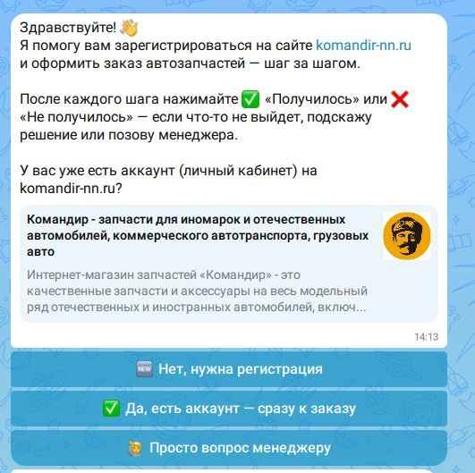
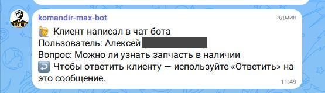

# komandir-max-bot

Тот же бот-инструктор, что и `komandir-telegram-bot`, но для мессенджера
**MAX** — независимая копия, работает отдельно от Telegram-версии. Бот
создан через [dev.max.ru](https://dev.max.ru) (аналог @BotFather в
Telegram), а затем зарегистрирован в кабинете
[business.max.ru](https://business.max.ru), на базе верифицированного
профиля организации (без него бот не создать).

Сценарий (`src/steps.js`) полностью совпадает с Telegram-версией — это
отдельная копия файла, а не общий модуль (см. «Известные ограничения» ниже
про синхронизацию правок).

Написано по официальному SDK `@maxhub/max-bot-api`. В проде работает под
pm2 (`komandir-max-bot`, см. `ecosystem.config.cjs`).

## Скриншоты

| Старт | Заявка в чате менеджеров |
|---|---|
|  |  |

## Установка

1. Установите Node.js 20.19+ (проверялось на v24).
2. В этой папке выполните:
   ```
   npm install
   ```
3. Получите токен бота: создайте бота на [dev.max.ru](https://dev.max.ru),
   затем зарегистрируйте его в кабинете
   [business.max.ru](https://business.max.ru) — кабинет выдаст токен.
4. Скопируйте `.env.example` в `.env` и заполните:
   - `BOT_TOKEN` — токен из кабинета business.max.ru.
   - `MANAGER_USER_ID` — `user_id` менеджера в MAX, которому бот будет слать
     сообщения о застрявших пользователях. Чтобы узнать свой `user_id` —
     временно добавьте в любой обработчик в `src/bot.js` строку
     `console.log(ctx.user)` и посмотрите поле `user_id` в консоли после
     того, как напишете боту. Если оставить пустым — бот покажет пользователю
     телефон/почту вместо пересылки менеджеру.
   - `COMPANY_PHONE`, `COMPANY_PHONE_2`, `COMPANY_EMAIL` — запасные контакты.
5. Запуск:
   ```
   npm start
   ```
   Бот работает через long polling со встроенным в SDK автопереподключением
   (`retry: true`) — отдельный сервер/домен не нужен.

## Постоянная работа (как у Telegram-версии)

Как и `komandir-telegram-bot`, для постоянной работы стоит запускать через
pm2:
```
pm2 start src/bot.js --name komandir-max-bot
```

## Команды бота

- `/start` (а также автоматически при первом открытии чата с ботом) — начать
  сценарий сначала.
- `/order` — сразу перейти к оформлению заказа (для тех, у кого аккаунт уже есть).
- `/help` — краткая справка и контакты магазина.

## Ссылка после регистрации (предложение помощи)

Бот не может написать клиенту первым — он пишет только тем, кто сам открыл чат.
Поэтому после регистрации на сайте клиенту даётся ссылка на бота с параметром:

    https://max.ru/id5257052602_bot?start=registered

(ссылку разместить в письме о регистрации и на странице «Спасибо» в панели ABCP).
Клиент нажимает «Начать» — бот присылает приветствие `welcome_registered`
(steps.js) с кнопками: помощь с подбором (заявка уходит в MANAGER_CHAT_ID, как и
«Вопрос менеджеру»), пошаговое оформление заказа, вопрос менеджеру, «пока не нужно».
Без параметра `?start=registered` бот показывает обычное приветствие.
В журнале `data/events.jsonl` у события `start` есть поле `payload` —
по нему видно, сколько человек пришло по ссылке из письма.

## Помощь менеджера: телефон и ответ прямо в чате (22.09.2026)

Когда пользователь застревает на шаге (❌ «Не получилось» → 🙋 «Всё ещё не получается —
позвать менеджера»), бот сначала предлагает поделиться телефоном — нативной кнопкой
«📞 Отправить номер» (MAX присылает vCard, номер парсится из `TEL:` внутри `vcf_info`
вложения `contact` — готового поля с номером в самом вложении нет). Можно пропустить и
просто написать вопрос текстом — это не блокирует отправку. Для обычных «просто вопрос
менеджеру» (через меню, без ❌) телефон не запрашивается — осознанный выбор, чтобы не
создавать трение там, где человек хочет просто что-то узнать.

**Менеджер отвечает клиенту без поиска по id — но только если у бота есть право читать
все сообщения группы.** На пересланную в `MANAGER_CHAT_ID` заявку менеджер отвечает через
нативное «Ответить» на это же сообщение — бот находит клиента по `chat_id`, привязанному
к `mid` заявки, и пересылает ответ. **Обязательное условие (реально найденная на живом
боте причина, почему это поначалу не работало):** бот должен быть **администратором** в
группе `MANAGER_CHAT_ID` — обычный участник получает только коллбэки своих кнопок, но не
видит сообщения других участников (в т.ч. reply), даже адресованные ему самому. Без этого
права можно годами не понять, почему ответы менеджера просто пропадают: ошибок при этом
не возникает, `message_created` для чужих сообщений в чате бот попросту не получает.
Выдаётся через настройки группы в MAX (участники → бот → сделать администратором) —
владельцем/админом группы, не самим ботом. Работает только для группового
`MANAGER_CHAT_ID`, не для личных сообщений через `MANAGER_USER_ID`. Привязка
«сообщение → клиент» хранится в памяти процесса (до 500 последних заявок), не переживает
перезапуск бота.

**Разовый ответ клиенту без чата** (если заявка старая и её `mid` уже не отслеживается,
либо после перезапуска бота): `NODE_EXTRA_CA_CERTS="$PWD/russian-trusted-ca.pem" node
reply-to-client.js <user_id> "текст"` — отправляет сообщение по `user_id` напрямую через
`sendMessageToUser`, не трогая живой процесс. `user_id` берите из самой заявки, строка
«Пользователь: Имя (id …)» (это `user_id`, а не `chat_id` — они разные числа в MAX).

## Данные

- `data/state.json` — последний шаг каждого пользователя (переживает перезапуск).
- `data/stuck-log.jsonl` — лог того, на каких шагах люди чаще всего нажимают
  «Не получилось».
- `data/events.jsonl` — журнал всех событий (старт, шаги, ✅/❌, вопросы менеджеру,
  телефоны, ответы менеджера) для статистики. Разбор: `python ../bot_stats.py`
  (или `--bot max`, `--days N`) — воронка по шагам, доля дошедших до конца,
  сколько вопросов доставлено и отвечено.

Обе папки не попадают в git (см. `.gitignore`).

## Известные ограничения и отличия от Telegram-версии

- **Сценарий не переиспользуется, а продублирован.** Если поменяете текст
  шага в одном из ботов (Telegram или MAX) — не забудьте поправить и второй
  `steps.js`, иначе тексты разойдутся. Осознанный компромисс ради того, чтобы
  боты были полностью независимы друг от друга (по вашему запросу).
- **API MAX (`@maxhub/max-bot-api`) на момент написания — версия 0.3.1**,
  то есть до релиза 1.0 — некоторые детали (особенно `ctx.answerOnCallback`,
  точный формат ошибок) могут отличаться от того, что описано в
  документации на GitHub. Код написан по сверенным вживую TypeScript-типам
  пакета, но финальную проверку может дать только реальный запуск.
- В отличие от Telegraf (Telegram), у SDK MAX есть встроенный `retry: true`
  для polling — на него и рассчитываем в первую очередь, а внешний цикл
  переподключения в `bot.js` (как в Telegram-версии) оставлен только как
  подстраховка на случай сбоя самого первого подключения.
- Добавлен `bot.catch(...)` — глобальный обработчик ошибок, которого не было
  в изначальной Telegram-версии и из-за отсутствия которого один кратковременный
  сетевой сбой на реальном пользователе на время «ронял» весь Telegram-бот
  целиком (см. соответствующий комментарий в коде). Стоит перенести это же
  исправление и в `komandir-telegram-bot`.
